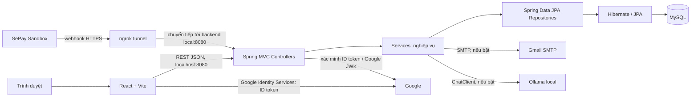
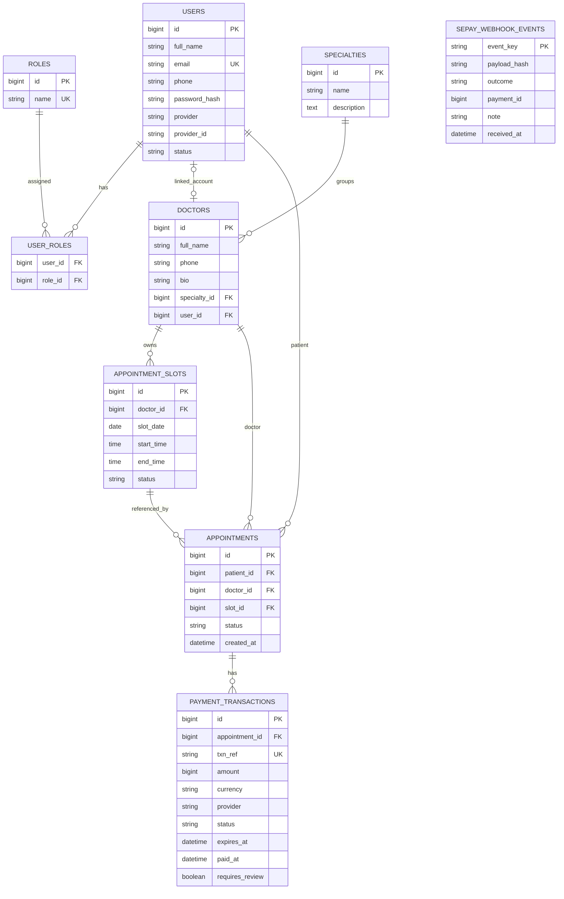

# MediBook

MediBook là đồ án website đặt lịch khám. Bệnh nhân xem chuyên khoa, bác sĩ và khung giờ; bác sĩ xử lý lịch thuộc hồ sơ của mình; quản trị viên quản lý một số dữ liệu danh mục. Frontend và backend là hai ứng dụng riêng, trao đổi qua REST API.

> **Phạm vi:** Đây là ứng dụng học tập, không phải hệ thống y tế hay cổng thanh toán sản xuất. SePay đang được dùng trong luồng Sandbox; không thu tiền thật. Đề bài được cung cấp yêu cầu VNPay hoặc MoMo, vì vậy SePay là sai khác cần được giảng viên chấp thuận riêng. Chưa có căn cứ trong source để nói việc thay cổng đã được chấp thuận.

## Mục lục

- [Trạng thái và giới hạn](#trạng-thái-và-giới-hạn)
- [Công nghệ](#công-nghệ)
- [Kiến trúc](#kiến-trúc)
- [Vai trò và màn hình](#vai-trò-và-màn-hình)
- [Luồng nghiệp vụ](#luồng-nghiệp-vụ)
- [Cơ sở dữ liệu](#cơ-sở-dữ-liệu)
- [Cấu trúc source](#cấu-trúc-source)
- [API chính](#api-chính)
- [Đối chiếu yêu cầu đồ án](#đối-chiếu-yêu-cầu-đồ-án)
- [Kiểm thử và bằng chứng](#kiểm-thử-và-bằng-chứng)
- [Cần xác nhận](#cần-xác-nhận)
- [Hướng dẫn thao tác](#hướng-dẫn-thao-tác)

## Trạng thái và giới hạn

Các nhãn dưới đây phân biệt code có trong repository với hoạt động đã kiểm chứng:

- **Có trong source:** đã tìm thấy triển khai; không đồng nghĩa đã chạy được.
- **Đã được báo cáo:** người phát triển từng báo một lần kiểm tra; không phải kết quả kiểm thử của lần viết tài liệu này.
- **Cần demo:** cần chạy ở môi trường phù hợp để xác nhận tích hợp và giao diện.

| Khu vực | Trạng thái theo source | Giới hạn/bằng chứng |
|---|---|---|
| Đăng ký, email/mật khẩu, JWT | Có trong source | Chưa chạy trong đợt soạn tài liệu |
| Google login | Có trong source | Google Identity Services gửi ID token; cần client ID và kết nối Google. Facebook login chưa thấy |
| Đặt, xem, hủy lịch | Có trong source | Hủy chỉ áp dụng cho lịch `PENDING` trước giờ khám, còn slot `BOOKED`, không có thanh toán `SUCCESS` hay giao dịch cần review |
| Bác sĩ xác nhận/hoàn thành | Có trong source | Xác nhận cần giao dịch SePay `SUCCESS` sạch; hoàn thành cần lịch `CONFIRMED` và đã đến/qua giờ kết thúc |
| SePay | Có trong source | Luồng Sandbox. Người phát triển trước đây báo đã thanh toán Sandbox thành công; tài liệu này không tái chạy hoặc tái xác nhận giao dịch đó |
| Email | Có trong source | Gửi qua Spring Mail khi đặt/hủy/xác nhận/hoàn thành; chưa kiểm tra SMTP trong lượt này |
| Trợ lý AI | Có trong source | Backend gọi Spring AI `ChatClient` tới Ollama; chưa kiểm tra model đang chạy |
| 11 route màn hình | Có trong source | Đếm route trong `frontend/src/App.jsx`; chưa xác nhận hiển thị bằng demo |
| Báo cáo học thuật | Chưa xác minh | Không thấy báo cáo học thuật trong source đã rà; README kỹ thuật này không thay thế báo cáo nộp môn |

### Các giới hạn đã thấy trong source

- Không thấy Facebook login.
- Không có API đổi hoặc đặt lại lịch; bệnh nhân có thể hủy khi đủ điều kiện rồi đặt một lịch mới nếu slot khác còn trống. Lịch cũ được giữ ở trạng thái `CANCELLED`.
- Không có quy trình hoàn tiền hoặc xóa trạng thái review. Giao dịch bị review cần phòng khám kiểm tra ngoài hệ thống.
- Không có màn hình admin quản lý tài khoản bệnh nhân, màn hình báo cáo/thống kê, hay màn hình xử lý hoàn tiền.
- AI chỉ hướng dẫn sử dụng website; service không đọc database, lịch cá nhân, slot trống, hoặc hộp thư.
- Vẫn còn các lớp/cấu hình VNPAY cũ. Payment service đang dùng trong UI tạo giao dịch provider `SEPAY`; `PaymentTransaction` vẫn có giá trị mặc định provider `VNPAY`. Không nên hiểu điều này là VNPay đang được tích hợp đầy đủ.
- Prompt trong `AiAssistantService` còn ghi thanh toán online “đang được phát triển”, không khớp với luồng SePay hiện tại.
- Cấu hình mẫu dùng database `medibook`; seeder chỉ cho phép chạy trên database tên `medibook_demo`. Không đọc `application.properties` local trong lần kiểm kê này nên không xác nhận cấu hình máy hiện tại.
- `ddl-auto=update` trong cấu hình mẫu có thể thay đổi schema khi ứng dụng khởi động. Không trỏ ứng dụng vào database có dữ liệu quan trọng nếu chưa sao lưu và hiểu rõ cấu hình.
- Không có migration SQL hoặc Postman collection trong các file đã rà.

## Công nghệ

Phiên bản backend lấy từ `backend/pom.xml`; frontend lấy từ `frontend/package.json` và lockfile. Dấu `^` là khoảng phiên bản khai báo, không phải khẳng định phiên bản đang chạy trên mọi máy.

| Phần | Công nghệ/phiên bản khai báo |
|---|---|
| Backend | Java target 17; Spring Boot 4.1.2; Maven Wrapper 3.3.4, phân phối Maven 3.10.0 |
| Web/API | Spring Web MVC; REST JSON |
| Persistence | Spring Data JPA, Hibernate, MySQL Connector/J |
| Security | Spring Security; JWT với JJWT 0.12.6; BCrypt |
| Validation | Jakarta Bean Validation |
| API docs | Springdoc OpenAPI / Swagger UI 3.2.0 |
| Email | Spring Mail (`JavaMailSender`) |
| AI | Spring AI 2.0.0, Ollama model starter; cấu hình mẫu chọn `qwen2.5:3b` |
| Frontend | React `^19.3.1`, Vite `^8.3.6`, React Router `^7.18.5`, Bootstrap `^5.3.8`, Axios `^1.21.0` |
| Frontend tooling | npm; có `package-lock.json`; script `dev`, `build`, `lint`, `preview` |
| Database server | MySQL trong cấu hình mẫu; phiên bản server không được pin trong manifest |

Ứng dụng là backend Spring Boot theo package/layer, không thấy cấu trúc microservice. Không có bằng chứng repository này triển khai frontend/backend lên Cloud.

## Kiến trúc



- Browser gọi API qua các module `frontend/src/api/`; nhiều API hiện hardcode `http://localhost:8080`. `VITE_GOOGLE_CLIENT_ID` chỉ là Google Web Client ID công khai dùng cho frontend, không phải nơi đặt secret.
- Backend xác minh JWT của MediBook trên API cần đăng nhập; phân quyền backend không dựa riêng vào `ProtectedRoute` phía React.
- Google login là luồng Google Identity Services cấp ID token. Frontend gửi credential lên `/api/auth/google`; backend xác minh chữ ký/issuer/audience rồi phát hành JWT MediBook. Source không cho thấy luồng OAuth redirect/callback truyền thống.
- ngrok chỉ tạo đường truy cập công khai tới backend local để nhà cung cấp gọi webhook. Nó **không** triển khai toàn bộ ứng dụng lên Cloud, không làm frontend/backend thành dịch vụ production.
- Ollama là mô hình local theo cấu hình mẫu. AI không truy vấn MySQL.

## Vai trò và màn hình

Role được khởi tạo nếu thiếu: `ROLE_PATIENT`, `ROLE_DOCTOR`, `ROLE_ADMIN`. API backend bảo vệ các hành động theo role; trang React chỉ điều hướng/ẩn chức năng cho UX.

| Vai trò | Chức năng có trong source | Màn hình |
|---|---|---|
| Khách/chưa đăng nhập | Xem trang chủ, chuyên khoa, bác sĩ; đăng ký và đăng nhập | `/`, `/specialties`, `/doctors`, `/register`, `/login` |
| `PATIENT` | Đặt lịch, xem lịch của mình, mở chi tiết/tạo thông tin thanh toán SePay, hủy lịch nếu đủ điều kiện | `/booking`, `/my-appointments` |
| `DOCTOR` | Xem lịch thuộc hồ sơ được liên kết; xác nhận/hoàn thành theo điều kiện nghiệp vụ | `/doctor/appointments` |
| `ADMIN` | Quản lý chuyên khoa, hồ sơ bác sĩ, khung giờ; liên kết tài khoản với hồ sơ bác sĩ | `/admin/specialties`, `/admin/doctors`, `/admin/appointment-slots` |

Đếm route sản phẩm theo `App.jsx`: **11 màn hình**. Không tính fallback `*`, modal/panel, Google button hay widget AI.

| Màn hình | Route | Vai trò | File | Mục đích |
|---|---|---|---|---|
| Trang chủ | `/` | Công khai | `frontend/src/pages/Home.jsx` | Giới thiệu, hiển thị chuyên khoa/bác sĩ |
| Chuyên khoa | `/specialties` | Công khai | `frontend/src/pages/Specialties.jsx` | Tìm và xem chuyên khoa |
| Bác sĩ | `/doctors` | Công khai | `frontend/src/pages/Doctors.jsx` | Tìm theo tên, lọc chuyên khoa |
| Đăng nhập | `/login` | Công khai | `frontend/src/pages/Login.jsx` | Email/mật khẩu hoặc Google |
| Đăng ký | `/register` | Công khai | `frontend/src/pages/Register.jsx` | Tạo tài khoản bệnh nhân |
| Đặt lịch | `/booking` | Bệnh nhân | `frontend/src/pages/Booking.jsx` | Chọn bác sĩ, ngày và slot |
| Lịch hẹn của tôi | `/my-appointments` | Bệnh nhân | `frontend/src/pages/MyAppointments.jsx` | Theo dõi/hủy lịch; mở panel thanh toán |
| Quản lý chuyên khoa | `/admin/specialties` | Admin | `frontend/src/pages/AdminSpecialties.jsx` | Thêm/sửa/xóa chuyên khoa |
| Quản lý bác sĩ | `/admin/doctors` | Admin | `frontend/src/pages/AdminDoctors.jsx` | Thêm/sửa hồ sơ và liên kết tài khoản |
| Quản lý khung giờ | `/admin/appointment-slots` | Admin | `frontend/src/pages/AdminAppointmentSlots.jsx` | Tạo và lọc slot |
| Lịch khám của tôi | `/doctor/appointments` | Bác sĩ | `frontend/src/pages/DoctorAppointments.jsx` | Lọc, xác nhận/hoàn thành lịch |

Source dùng Bootstrap và CSS riêng có layout responsive; điều này không thay thế việc demo trực quan trên kích thước màn hình cần trình bày.

## Luồng nghiệp vụ

### Tài khoản và phân quyền

1. Đăng ký thường tạo tài khoản `ACTIVE` với `ROLE_PATIENT`; mật khẩu được mã hóa BCrypt.
2. Đăng nhập thường trả JWT MediBook. JWT filter tải user/roles hiện hành từ database và từ chối user không còn `ACTIVE`.
3. Google login hỗ trợ Gmail hoặc Google Workspace có email xác minh. Tài khoản Google mới được tạo với `ROLE_PATIENT`; admin không đăng nhập bằng Google theo code hiện tại. Facebook chưa có trong source.
4. Admin có thể liên kết tài khoản đã đăng ký với hồ sơ bác sĩ. Thao tác thêm `ROLE_DOCTOR`, giữ role cũ, và bác sĩ cần đăng xuất/đăng nhập lại để giao diện cập nhật.
5. Lưu ý: `AuthService.login` kiểm tra mật khẩu nhưng chưa kiểm tra `ACTIVE` trước khi phát JWT. API tiếp theo vẫn bị JWT filter từ chối nếu tài khoản không hoạt động.

### Đặt, hủy và hoàn thành lịch

- Slot phải tồn tại, có status `AVAILABLE`, và thời điểm bắt đầu ở tương lai. Backend khóa bản ghi slot trong transaction trước khi đặt; tạo appointment `PENDING` và đổi slot thành `BOOKED`.
- Một appointment lưu riêng bệnh nhân, bác sĩ, slot và status. Không có API đổi/reschedule; đặt lại là hủy lịch cũ khi đủ điều kiện rồi chọn slot khác.
- Chỉ bệnh nhân sở hữu lịch mới hủy được; lịch phải `PENDING`, trước giờ bắt đầu, slot `BOOKED`, và không có payment `SUCCESS` hay payment `requiresReview=true`. Khi hủy, appointment được giữ ở `CANCELLED` và slot chuyển `AVAILABLE`.
- Bác sĩ phải có tài khoản `ACTIVE`, `ROLE_DOCTOR`, được liên kết với hồ sơ sở hữu appointment. Chỉ lịch `PENDING` và slot `BOOKED` mới có thể xác nhận; phải có ít nhất một payment `SEPAY` `SUCCESS` sạch, đồng thời không payment nào của lịch cần review.
- Chỉ lịch `CONFIRMED`, slot `BOOKED`, và đã đến/qua giờ kết thúc mới được hoàn thành (`COMPLETED`). Slot vẫn `BOOKED`.
- Service dùng `@Transactional` và repository có truy vấn `PESSIMISTIC_WRITE` cho các luồng tương ứng. Unit test dùng mock không xác minh khóa/transaction/rollback/race condition thực sự trên MySQL.

### Thanh toán SePay Sandbox

1. Bệnh nhân mở **Thanh toán / Chi tiết** trên lịch của mình. Đọc trạng thái là `GET` và không tạo giao dịch.
2. Khi người dùng nhấn **Tạo thông tin thanh toán SePay Sandbox**, frontend mới gọi `POST`. Backend tự xác định số tiền/provider/trạng thái; không tin các giá trị đó từ client.
3. Backend tạo hoặc trả lại giao dịch `PENDING` còn hạn. Mã tham chiếu do backend sinh; không nhập mã lịch/giao dịch cũ vào tài liệu hoặc dùng lại cho demo.
4. SePay gọi `POST /api/payments/sepay/webhook` với header `Authorization: Apikey <khóa cấu hình backend>`. Backend kiểm tra người nhận/ngân hàng, chiều tiền vào, mã tham chiếu duy nhất, số tiền, thời gian/expiry; giao dịch lặp cùng ID và fingerprint được nhận diện.
5. Thanh toán thành công chỉ đổi **trạng thái payment**; không tự đổi trạng thái appointment thành `CONFIRMED`.

Trạng thái lịch (`PENDING`, `CONFIRMED`, `COMPLETED`, `CANCELLED`) và payment (`PENDING`, `SUCCESS`, `FAILED`) độc lập. `requiresReview` là cờ bổ sung, không phải giá trị của enum payment status. Payment `PENDING` hết hạn vẫn có status lưu `PENDING`; hết hạn được suy ra từ `expiresAt`, không có enum `EXPIRED`.

Khi có bất kỳ payment nào `requiresReview=true`, bác sĩ không thể xác nhận và UI yêu cầu liên hệ phòng khám. Khi đã có payment `SUCCESS`, UI không tạo thêm giao dịch. Nếu payment `SUCCESS` đồng thời có review, UI hiển thị cả hai. Giao dịch `PENDING` hết hạn không còn được trình bày như hướng dẫn thanh toán còn hiệu lực. Lịch đã hủy không hiển thị hướng dẫn chuyển khoản; tiền đến muộn có thể cần review.

Không có chức năng hoàn tiền/xóa review. Chỉ dùng Sandbox; không chuyển tiền thật.

### Email và Trợ lý AI

- Email Spring Mail được gọi khi đặt lịch, hủy lịch, bác sĩ xác nhận và hoàn thành. Không thấy email gửi khi thanh toán.
- Khi có transaction synchronization, email được gửi sau commit. Lỗi SMTP được ghi log và không biến thao tác nghiệp vụ đã lưu thành thất bại; không có hàng đợi/retry bền vững.
- Trợ lý AI là widget toàn cục, không phải màn hình route. `/api/ai/chat` gọi Spring AI `ChatClient` tới Ollama `qwen2.5:3b` theo cấu hình mẫu. Service không đưa lịch cá nhân/slot/database vào prompt và hướng dẫn không tư vấn chẩn đoán/điều trị. Prompt hiện còn chứa câu “thanh toán online đang được phát triển”; câu này đã cũ so với SePay Sandbox.

## Cơ sở dữ liệu

Entity JPA là nguồn mô tả quan hệ. Cấu hình mẫu dùng MySQL; Hibernate `ddl-auto=update` được khai báo, không có bộ migration SQL được tìm thấy.



`USER_ROLES` là join table JPA. `SEPAY_WEBHOOK_EVENTS.payment_id` lưu ID giao dịch nhưng entity không khai báo quan hệ/khóa ngoại JPA tới `PAYMENT_TRANSACTIONS`. Mặc dù nghiệp vụ mong mỗi slot chỉ được đặt một lần, cột `appointments.slot_id` trong entity không khai báo unique constraint; code dựa vào trạng thái slot và khóa trong service, không phải ràng buộc unique được chứng minh ở đây.

| Bảng | Vai trò |
|---|---|
| `users`, `roles`, `user_roles` | Tài khoản, role và liên kết nhiều-nhiều; `password_hash` là dữ liệu nhạy cảm, không truy vấn/in ra khi demo |
| `specialties`, `doctors` | Danh mục chuyên khoa, hồ sơ bác sĩ; `doctors.user_id` nullable/unique để liên kết tài khoản |
| `appointment_slots` | Lịch làm việc của bác sĩ; `AVAILABLE`/`BOOKED` |
| `appointments` | Lịch hẹn và trạng thái lịch |
| `payment_transactions` | Nhiều giao dịch có thể thuộc một lịch; `txn_ref` unique; lưu status và cờ/reason review |
| `sepay_webhook_events` | Dấu vết xử lý webhook, event key là khóa chính |

Không có entity `Patient` riêng: bệnh nhân là `User` có role `ROLE_PATIENT`.

## Cấu trúc source

```text
medibook/
├── backend/
│   ├── src/main/java/com/medibook/backend/
│   │   ├── config/       # Security, JWT, initializer/seeder
│   │   ├── controller/   # REST endpoints
│   │   ├── dto/          # Request/response API
│   │   ├── entity/       # JPA entities/enums
│   │   ├── repository/   # Spring Data JPA và truy vấn khóa
│   │   └── service/      # Nghiệp vụ
│   ├── src/main/resources/
│   │   └── application-example.properties
│   ├── src/test/java/    # Unit tests và context test
│   ├── pom.xml
│   └── mvnw.cmd
├── frontend/
│   ├── src/api/          # Các module gọi REST API
│   ├── src/components/   # Navbar, guards, widget, payment panel
│   ├── src/pages/        # Route screens
│   ├── src/App.jsx       # Route definitions
│   ├── package.json
│   └── package-lock.json
├── README.md
└── HUONG_DAN_CHAY_VA_DEMO.md
```

Ví dụ đặt lịch: `Booking.jsx` → `frontend/src/api/appointmentApi.js` → `AppointmentController` → `AppointmentService` → `AppointmentRepository`/`AppointmentSlotRepository` → JPA/MySQL. Service kiểm tra user/role/slot, khóa slot trong transaction, lưu lịch rồi đổi slot status; email được lên lịch sau commit nếu bật.

## API chính

API được khai báo trong controller. Các endpoint POST/PUT/DELETE có thể thay đổi dữ liệu; không bấm `Execute` với chúng trên database thật khi chỉ đang trình bày.

| Method + path | Ai được gọi | Ý nghĩa |
|---|---|---|
| `POST /api/auth/register` | Công khai | Tạo bệnh nhân; body gồm tên, email, mật khẩu và phone tùy chọn |
| `POST /api/auth/login` | Công khai | Đăng nhập email/mật khẩu |
| `POST /api/auth/google` | Công khai | Nhận Google ID token trong trường `credential` |
| `GET /api/auth/me` | Đã đăng nhập | Thông tin tài khoản hiện hành |
| `GET /api/specialties`, `GET /api/doctors`, `GET /api/appointment-slots` | Công khai | Đọc danh mục |
| `POST/PUT/DELETE /api/specialties...` | Admin | Quản lý chuyên khoa |
| `POST/PUT /api/doctors...` | Admin | Tạo/sửa hồ sơ bác sĩ |
| `POST /api/appointment-slots` | Admin | Tạo slot; backend kiểm tra thời gian và slot chồng lấn |
| `POST /api/admin/doctors/{doctorId}/account` | Admin | Liên kết email tài khoản đã đăng ký với hồ sơ bác sĩ |
| `GET /api/appointments/me` | Patient | Đọc lịch của mình |
| `POST /api/appointments` | Patient | Đặt lịch, body chứa `slotId` |
| `POST /api/appointments/{appointmentId}/cancel` | Chủ lịch là patient | Hủy lịch theo điều kiện |
| `GET /api/doctor/appointments` | Doctor | Đọc lịch của hồ sơ bác sĩ đã liên kết |
| `POST /api/doctor/appointments/{appointmentId}/confirm` | Doctor sở hữu lịch | Xác nhận theo điều kiện payment/status |
| `POST /api/doctor/appointments/{appointmentId}/complete` | Doctor sở hữu lịch | Hoàn thành sau giờ kết thúc |
| `POST /api/payments/sepay/appointments/{appointmentId}` | Patient sở hữu lịch | Tạo hoặc trả lại payment còn hiệu lực |
| `GET /api/payments/sepay/appointments/{appointmentId}` | Patient sở hữu lịch | Đọc danh sách payment, mới nhất trước; chưa có thì `[]` |
| `GET /api/payments/sepay/transactions/{paymentId}` | Patient sở hữu lịch | Đọc giao dịch SePay |
| `POST /api/payments/sepay/webhook` | Nhà cung cấp có API key hợp lệ | Nhận webhook; endpoint permit qua Spring Security nhưng tự kiểm tra API key ở controller |
| `POST /api/ai/chat` | Đã đăng nhập | Gửi câu hỏi cho AI |

Payment GET không tạo payment. API đọc lịch/payment kiểm tra quyền sở hữu ở service. Response payment có `receiverAccount`/`receiverGateway` chỉ khi provider là `SEPAY`; giao dịch provider khác không nhận thông tin tài khoản SePay.

Springdoc được khai báo và SecurityConfig cho phép `/swagger-ui/**` và `/v3/api-docs/**`. Mặc định Springdoc thường ở `/swagger-ui/index.html` và `/v3/api-docs`; source không thấy cấu hình Bearer security scheme riêng, nên không khẳng định nút Swagger `Authorize` đã được cấu hình.

## Đối chiếu yêu cầu đồ án

Các yêu cầu bên dưới là yêu cầu giảng viên do người phát triển cung cấp, không phải rubric đã xác minh độc lập.

| Tiêu chí | Bằng chứng trong source | Cần demo/giới hạn |
|---|---|---|
| Login Gmail hoặc Facebook | Google Identity Services và backend Google token verifier | Google có code; Facebook chưa thấy; cần cấu hình/demo Google |
| Tối thiểu 3 nhóm | `ROLE_PATIENT`, `ROLE_DOCTOR`, `ROLE_ADMIN`; backend security | Demo quyền thật trên backend, không chỉ dựa vào menu |
| VNPay hoặc MoMo | Luồng hiện tại là SePay Sandbox | **Sai khác yêu cầu**; cần giảng viên chấp thuận, không tự coi là tương đương |
| Spring Data JPA | Starter, entity và repository | Cần demo database được phép |
| Spring Email | Spring Mail/JavaMailSender | Cần demo SMTP; lỗi gửi được log, không retry bền vững |
| Tách frontend/backend | `frontend/` và `backend/`, REST API | Cần chạy hai ứng dụng cùng nhau |
| Giao diện dễ nhìn, khoảng 10 màn hình | 11 route screens; Bootstrap và CSS riêng | Cần demo trực quan; chưa đánh giá bằng hình ảnh/runtime |
| Báo cáo đầy đủ | Không thấy báo cáo học thuật trong source đã rà | Chuẩn bị tài liệu nộp môn riêng; README/hướng dẫn không thay thế báo cáo |
| Source tổ chức tốt | Tách page/component/API và package controller/service/repository/entity | Bằng chứng cấu trúc; không phải đánh giá toàn diện chất lượng |

**Điểm cộng:** Trợ lý AI có integration Ollama trong source. Không thấy bằng chứng microservice hay triển khai Cloud; ngrok chỉ có thể phục vụ tunnel webhook khi người phát triển tự cấu hình.

## Kiểm thử và bằng chứng

- `AppointmentServiceTest` và `DoctorAppointmentServiceTest` dùng JUnit/Mockito mock. Theo kết quả đã được người phát triển cung cấp trước đây, hai lớp này có **19 test pass**. Đây là kết quả lịch sử, không phải lệnh chạy trong lần soạn tài liệu.
- `SepayWebhookServiceTest` cũng dùng Mockito; trước đó từng được báo cáo **14 test pass**. Lần chạy SePay riêng gần đây dừng ở lỗi cấp phát native memory trước khi có kết quả test; `SepayWebhookServiceTest` không chạy trong lần đó. Không được coi lần lỗi JVM đó là lỗi assertion, cũng không coi báo cáo cũ là kết quả mới.
- `SepayPaymentServiceTest` và `SepayWebhookServiceTest` là test service với mock; không chứng minh tích hợp thật.
- `BackendApplicationTests` có `@SpringBootTest`; chạy toàn bộ suite có thể khởi động Spring context và cần cấu hình datasource. Không chạy mù quáng nếu chưa xác định môi trường test cô lập.
- Mockito agent được cấu hình trong Surefire ở `backend/pom.xml`. Test cần static mock thời gian; không đổi mock maker để né agent.
- Unit test với mock **không chứng minh** transaction/dirty checking/locking, rollback trên DB, hai request cùng slot, webhook qua ngrok, SMTP, Google, SePay Sandbox hoặc Ollama.
- Các thay đổi README này không được kiểm chứng bằng build/test trong lượt này.

## Cần xác nhận

1. Giảng viên có chấp thuận SePay thay cho VNPay/MoMo không? Cần hỏi/xem rubric chính thức.
2. Cấu hình `application.properties` local và database đang dùng là gì? Chưa đọc file đó; cấu hình mẫu lại trỏ `medibook`, còn seeder chỉ chấp nhận `medibook_demo`.
3. Google Web Client ID/origin được cấu hình hợp lệ chưa? Chưa thử Google hoặc gọi Google.
4. Gmail SMTP/App Password và các sự kiện email có hoạt động ở máy demo không? Chưa gửi thư.
5. SePay Sandbox có nhận đúng endpoint/header trong cấu hình hiện tại không? Tên trường trên giao diện nhà cung cấp cần xem trực tiếp; tài liệu này không gọi dịch vụ.
6. Ollama/model có sẵn trên máy trình bày không? Chưa khởi chạy.
7. Các màn hình có hiển thị đẹp/đúng ở kích thước thiết bị trình bày không? Chưa chạy frontend.
8. Báo cáo học thuật có tồn tại ở nơi khác ngoài source workspace không?

## Hướng dẫn thao tác

Xem [HUONG_DAN_CHAY_VA_DEMO.md](./HUONG_DAN_CHAY_VA_DEMO.md) để cài đặt, thiết lập môi trường, chạy từng tích hợp, demo, xem API/database, chạy test chọn lọc và xử lý lỗi thường gặp.
